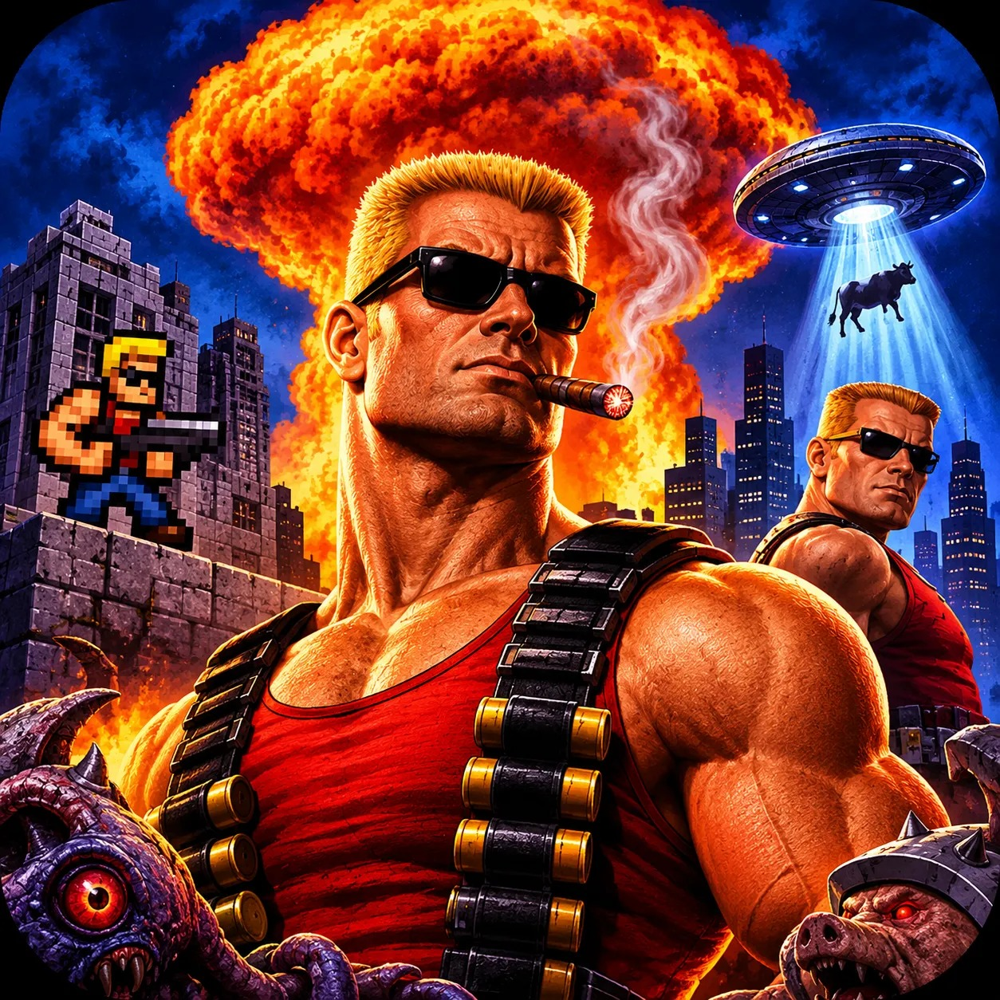

# Duke Nukem 3D Android Edition



Duke Nukem 3D para Android con los archivos de tu copia de **Duke Nukem 3D: Megaton Edition**
(Steam), incluidas las expansiones *Duke It Out in D.C.*, *Nuclear Winter* y *Caribbean: Life's
a Beach*. Un solo APK, **Duke Legacy** (`Duke-Legacy-0.1.N.apk`), con dos versiones de Duke
Nukem 3D que se eligen en el lanzador (**HD / CLASSIC**, con Start o tocando el selector):

| | **HD** | **Classic** |
|---|---|---|
| Motor | [Raze](https://github.com/ZDoom/Raze), OpenGL ES | [EDuke32](https://www.eduke32.com), dibujo por software |
| Aspecto | Pack HD (HRP) con modelos 3D, luces dinámicas y sombras | El original, con filtros de imagen |
| Campañas y mods de EDuke32 | Solo mods de gráficos y sonido | Sí (Alien Armageddon, DNF 2013, Duke 64...) |
| Ajustes | Los suyos | Los suyos (independientes) |

Los APK **no incluyen ningún archivo del juego**: hay que copiarlos de tu copia de Steam.

## Cómo jugar

1. Instala el APK.
2. En Steam: clic derecho en *Duke Nukem 3D: Megaton Edition* → *Administrar* → *Ver archivos
   locales*. Copia la carpeta **`gameroot`** al móvil o consola, dentro de una carpeta
   **`Duke3D`** en la raíz de la memoria:

   ```
   /storage/emulated/0/Duke3D/gameroot/DUKE3D.GRP
   /storage/emulated/0/Duke3D/gameroot/addons/dc/…
   /storage/emulated/0/Duke3D/gameroot/addons/nw/…
   /storage/emulated/0/Duke3D/gameroot/addons/vacation/…
   ```

   También vale copiar solo el contenido de `gameroot` directamente en `Duke3D`. ¿Prefieres
   otra carpeta? Con **Elegir carpeta** la app lee los archivos de la carpeta que quieras (también
   en la tarjeta SD).
3. Abre la app, da el permiso de archivos y elige el juego o la expansión.

La configuración y las partidas guardadas se quedan en la carpeta del juego. Si el juego se
cierra, al volver al menú la app enseña las últimas líneas del registro y lo guarda entero en
`registro.txt`, dentro de la carpeta `Duke3D` (también se crea con **Opciones → Generar registro**).

## El lanzador

Un menú con los gráficos del propio juego y con música:

- **Duke Nukem 3D**: el juego, las tres expansiones y *Penthouse Paradise* (el DLC gratuito de
  1997, si está en `Duke3D/extras`). En **Extras**: guía, reproductor de la música del juego y
  logros.
- **Duke Nukem** (los tres episodios) y **Duke Nukem II**, de MS-DOS, con DOSBox Pure. Van en
  `Duke3D/extras/duke1` y `Duke3D/extras/duke2`, en la sección **Classic** del lanzador.
- Solo en Duke Legacy, sección **Legacy**: *Duke Nukem: Time to Kill* y *Land of the Babes*, de
  PlayStation, con SwanStation. Los discos van en `Duke3D/extras/timetokill` y
  `Duke3D/extras/landofthebabes`; la BIOS es opcional (junto al disco o en `extras/bios`).

En Duke Legacy las secciones (Duke Nukem 3D, Classic y Legacy) se cambian con el botón Y o
tocando el pie del menú.

## Duke Legacy (HD)

- **Pack HD (HRP)**: texturas en alta resolución y **modelos 3D** animados de enemigos y objetos,
  con fundido entre posturas y giro suave. Las expansiones que redibujan gráficos (el Caribe)
  conservan los suyos.
- **Luces dinámicas**: explosiones, cohetes, fuego, rayos del congelador y del reductor, láseres y
  el fogonazo de tu arma iluminan paredes, suelos, enemigos y modelos.
- **Mods** (`Duke3D/mods/Graficos y sonido`, solo de la HD): cada mod tiene su interruptor en **Opciones** del
  lanzador y en el menú rápido. El pack HD y el XXX vienen activados de serie (los que lleven
  «hrp», «hd» o «xxx» en el nombre).
- **Menú rápido** (Atrás, solo en plena partida):
  - **Trucos**: modo dios, atravesar paredes, armas, munición, llaves, vida, armadura...
  - **Ajustes → Gráficos**: resolución, perfil (Rendimiento / Equilibrado / Calidad), filtrado,
    anisotrópico, texturas suavizadas, modelos 3D, texturas HD, vóxeles, sombras, luces
    dinámicas, campo de visión (70°-120°, 90° de serie) y límite de FPS.
  - **Ajustes → Imagen**: tamaño de pantalla y estilo del HUD, escala del HUD, retícula (sí/no,
    tipo y tamaño), emulación de paleta, contador de FPS y **Restablecer imagen**.
  - **Ajustes → Controles**: controles táctiles, sensibilidad, **giroscopio** (apuntar moviendo
    el móvil, con inversión horizontal y vertical), vibración y configurar mando.
  - **Ajustes → Mods**: activar y desactivar mods y **Reiniciar con los mods**.
  - Volver al lanzador y Salir (también están en el menú del juego).
- En los ajustes, izquierda y derecha bajan y suben cada valor.

## Classic

- Dentro de Duke Legacy: en la sección Duke Nukem 3D, **Start** (o tocar el selector de arriba)
  cambia entre **HD** y **CLASSIC**. Sus ajustes, mods y campañas son independientes de la HD.
- El motor EDuke32 original, con filtros de imagen: escalado, FXAA, nitidez, resplandor, color
  y efecto CRT / LCD.
- **Mods propios**, distintos de los de la HD: campañas completas en `Duke3D/mods/Campanas Classic`
  y mods de gráficos y sonido (audio HD, vóxeles...) en `Duke3D/mods/Graficos y sonido Classic`,
  en carpeta, `.zip`, `.pk3` o `.grp`. Los de `Graficos y sonido` son solo de la HD. El pack HD y
  el XXX no salen en la Classic (el dibujo por software no los usa).
- El mismo menú rápido: trucos, gráficos, controles, vibración, volver al lanzador y salir.

## Controles

- **Táctiles**: joystick para moverse, arrastrar para mirar y botones de acción. En modo
  automático se ocultan al usar el mando y vuelven al tocar la pantalla.
- **Mando**: R2 disparar, L2 patada, A saltar, B agacharse, X usar, Y usar objeto, L1/R1 arma
  anterior y siguiente, cruceta para el inventario, Select el mapa y Start el menú del juego.
  Cada botón se puede cambiar en **Configurar mando**, con la sensibilidad de cada stick.
- **Vibración** al recibir daño, disparar y con los terremotos (también en el mando, si vibra).
- **Logros** propios de cada juego y expansión.

## Castellano

En **Opciones → Idioma** se elige castellano o inglés para el lanzador y el juego. En la Classic
la traducción (`android/app/src/main/assets/traduccion_es.txt`) se aplica por encima de tus
archivos al arrancar, con las letras con tilde hechas a partir de las del juego; Duke Legacy usa
la traducción de Raze.

## Compilar

Con GitHub Actions (**Actions → Run workflow → Raze**); el APK sale como artefacto del run.
Raze, DOSBox Pure y SwanStation se descargan y se parchean al compilar (los cambios a Raze están
en `raze/parchear.py`); EDuke32 (la Classic) se compila desde `eduke32/`.

Para que cada APK se instale encima del anterior, añade estos secretos del repositorio (si no,
se firma con una clave de depuración distinta en cada compilación):

- `SIGNING_KEYSTORE_BASE64`: el `.p12` en base64.
- `SIGNING_STORE_PASSWORD`: su contraseña.
- Opcionales: `SIGNING_KEY_ALIAS` (si no, se usa el primer alias de la clave) y
  `SIGNING_KEY_PASSWORD` (si no, la misma que la del almacén).

## Estructura

- `eduke32/`: código de EDuke32 con los cambios para Android (ver `eduke32/PARCHES.md`).
- `raze/`: cambios a Raze (`parchear.py`), su puente con la app (`android/android_raze.cpp`) y
  los de ZMusic.
- `android/`: proyecto Android: el lanzador en Java (`src/eduke32` la Classic, `src/raze` Duke
  Legacy), SDL2 y la compilación con CMake.

## Licencias y aviso legal

- EDuke32: GPL v2 (`eduke32/gpl-2.0.txt`) y licencia del motor BUILD (`eduke32/buildlic.txt`).
  La licencia BUILD no permite uso comercial: este proyecto es gratuito.
- Raze: GPL v3 (con partes bajo la licencia BUILD).
- DOSBox Pure: GPL v2. SwanStation: GPL v3. SDL2: licencia zlib.
- Duke Nukem 3D, sus expansiones y el resto de juegos son de sus respectivos dueños. Este
  proyecto no está afiliado a ellos ni distribuye ningún archivo de los juegos ni de los mods.
